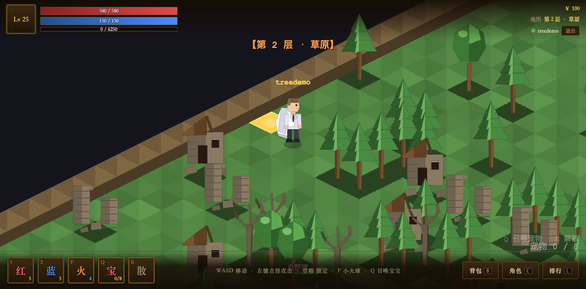
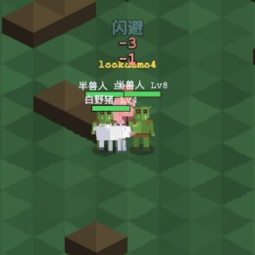
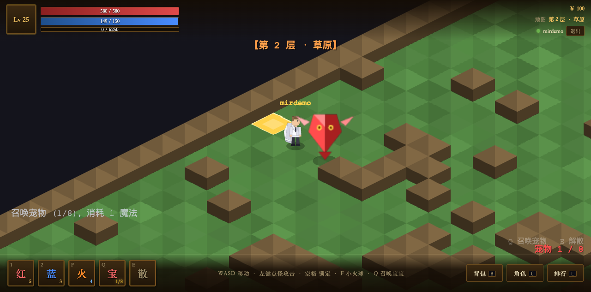
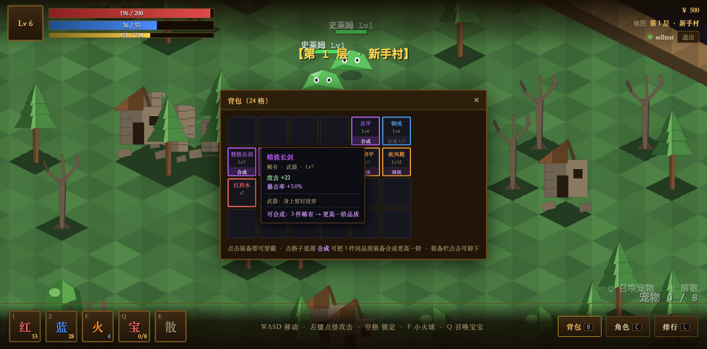

# 传奇 · 简易网页版

斜 45° 等距视角的传奇类网页游戏。打怪 → 掉落 → 升级 → 换装变强，核心闭环完整可玩。



## 游戏截图

**主角**：白西装 + 白披风的欧洲人形象，low poly 切面造型：


**怪物**：半兽人（Lv8）与白野猪（Lv4）围攻玩家，背后还有一只在打的森林狼：



**底部快捷栏**：红/蓝药水、小火球（F）、**召唤宝宝（Q）/ 解散（E）**，
点击或按键都可以；槽位右下角实时显示宠物数量与耗蓝：



**背包**：格子底部的「合成」角标（3 件同品质 → 更高一阶），史诗显示「满级」、
材料不够自动压暗；鼠标悬停还会和身上穿的装备**逐项对比**（绿色变强 / 红色变弱）：



## 启动

```bash
# 一键后台启动（推荐：后台常驻，关终端不受影响）
./server.sh start

# 其它命令
./server.sh status     # 查看运行状态
./server.sh restart    # 重启（会先优雅存档）
./server.sh stop       # 停止
./server.sh log        # 实时查看日志（Ctrl+C 退出）
```

浏览器打开 **http://localhost:8099**，注册账号即玩。

> ⚠️ **不要直接 `node server/index.js`** —— 那是前台进程，终端一关服务就没了，
> 表现为"服务莫名其妙停了"。`server.sh` 内部走标准 daemonize（双重 fork + `setsid`），
> 让进程与终端/会话完全解耦，并把 PID 记到 `logs/server.pid` 方便精确停止。

> 8080 常被开发机上的其它服务占用，所以默认端口是 8099。换端口：`PORT=9000 ./server.sh start`

### 启动 / 发布命令

日常用这条就够了（先 `cd` 到 clone 下来的项目目录）：

```bash
cd legend-web-game && ./server.sh start
```

macOS 想开机自启，可以自己写一个 LaunchAgent（`RunAtLoad` + `KeepAlive`），
把 `ProgramArguments` 指向本机的 `node` 路径与 `<项目目录>/server/index.js` 即可。

脚本自带守护化（daemonize 双重 fork），**关掉终端也不会停**，日志在 `logs/server.log`。
其余操作：

| 命令 | 作用 |
|---|---|
| `./server.sh start` | 后台启动（改端口：`PORT=9000 ./server.sh start`） |
| `./server.sh stop` | 停止（会先存档再退出） |
| `./server.sh restart` | 重启 |
| `./server.sh status` | 查看状态 |
| `./server.sh log` | 实时看日志（Ctrl+C 退出） |
| `npm start` | 等价的前台启动（终端关了就停，调试用） |

启动后本机访问 `http://localhost:8099`；同一 WiFi 的朋友用 `http://<你的局域网IP>:8099`
（IP 用 `ipconfig getifaddr en0` 查，路由器变了会跟着变）。

> 想发到**公网**（任何人点链接就能玩）不靠命令，用 WorkBuddy 的「发布为应用」即可，
> 项目是零依赖 Node 服务、单端口，天然支持在线发布。

## 操作

| 按键 | 功能 |
|---|---|
| `W A S D` / 方向键 | 移动（屏幕方向即移动方向） |
| 鼠标左键点怪 | 锁定并持续攻击 |
| `空格` | 锁定最近的怪物 |
| `1` / `2` | 喝红药 / 蓝药 |
| `F` | 小火球（远程技能，耗蓝 4） |
| `Q` | 召唤一只宠物（耗魔法 1 点，最多同时 8 只） |
| `E` | 解散全部宠物 |
| `B` / `C` / `L` | 背包 / 角色 / 排行榜 |
| `Esc` | 关闭面板 / 取消攻击 |

**怎么闯关**：一路向右走到每张图的黄色传送点即可前进。打穿**魔王洞穴**的魔王后，
洞穴**最右侧**会出现闯关门，踩上去就进入下一层（层号显示在屏幕顶部中央和右上角）。

**背包里怎么合成装备**：按 `B` 打开背包 → 点格子**底部的「合成」角标**即可合成。
材料够时角标是亮的紫色「合成」，不够时压暗并显示 `合成 1/3`，史诗装备显示「满级」。
格子本体仍是"穿上"，只有角标是"合成"，两者互不干扰。

**换装备前怎么判断值不值**：鼠标悬停背包装备，说明里会多出一段
**「对比身上」** —— 拿它和当前同部位已穿的装备逐项对一遍（攻击 / 防御 / 生命 / 暴击率 …），
显示 `旧值 → 新值` 以及净差额，**变强是绿色 `+`、变弱是红色 `-`**。
该部位空着时会提示"身上暂时没穿"。这样不用自己心算、也不会换错装备。

## 玩法内容

- **4 张地图**：新手村 → 草原 → 幽暗森林 → 魔王洞穴（难度递增，走黄色传送点切换）
- **6 种怪物**（数值梯度：Lv1 → Lv10）：

  | 怪物 | 等级 | 出没地图 |
  |---|---|---|
  | 史莱姆 | Lv1 | 新手村、草原 |
  | 森林狼 | Lv3 | 草原、幽暗森林 |
  | 白野猪 | Lv4 | 草原、幽暗森林 |
  | 骷髅兵 | Lv6 | 幽暗森林、魔王洞穴 |
  | 半兽人 | Lv8 | 幽暗森林、魔王洞穴 |
  | 洞穴魔王（Boss） | Lv10 | 魔王洞穴 |
- **无尽闯关（层）**：**每张地图算一层**，层号随地图连续递增并无限循环：

  | 层 | 1 | 2 | 3 | 4 | 5 | 6 | 7 | 8 | 9 | … |
  |---|---|---|---|---|---|---|---|---|---|---|
  | 地图 | 新手村 | 草原 | 幽暗森林 | **魔王洞穴** | 新手村 | 草原 | 幽暗森林 | **魔王洞穴** | 新手村 | … |

  即「第 N 层」与「第 N + 4 层」是**同一张地图**，但数值按循环次数整体加强。
  **魔王每 4 层出现一次**（第 4、8、12…层），且它也跟着变强。
  打完本层魔王 → 洞穴最右侧的闯关门放行 → 进入下一层（回到新手村，数值更高一档）。
  **每层的魔王都要重新打**，否则下一层的门不会开。

  每往下一层，全体怪物按**加法**成长（不是复利，否则深层数会直接变成死局）：

  | 项目 | 每循环增幅 | 第 5 层效果 |
  |---|---|---|
  | 血量 | +40% | ×1.40 |
  | 攻击 | +30% | ×1.30 |
  | 防御 | +25% | ×1.25 |
  | 经验 / 金币 | +60% | ×1.60 |
  | 怪物等级 | +2 | Lv1 史莱姆 → Lv3 |

  掉落装备的等级同步上浮，品质权重也随层数提升（有上限，避免深层数只掉橙装）。
  所有系数集中在 `config.js` 的 `LAYER` 里，**一处可调**。
- **等级无上限**：配合无尽层数，20 级封顶会让深层数变成死局，所以解除了上限；
  经验曲线 `50 × Lv^1.5` 不变，后面的等级天然越来越慢，自带软性减速。
- **主动技能 · 小火球**（`F` 键，底部快捷栏也有技能槽可点）：
  **远程**（射程 6 格，普通攻击只有 1.4 格）+ **落点小范围溅射**，代价是耗蓝与冷却。

  | 项目 | 数值 |
  |---|---|
  | 耗蓝 | 4 |
  | 冷却 | 2.5s |
  | 射程 | 6 格 |
  | 伤害 | 攻击 × 2.0 − 目标防御 / 2（与普通攻击同一套公式，只是倍率更高） |
  | 溅射 | 落点 1.3 格内的其它怪再吃 50% 伤害 |

  两个细节：**施法不会锁定攻击目标**，所以不会像普通攻击那样自动贴上去，远程才成立；
  选目标是"优先当前锁定的怪，没有就自动取射程内最近的一只"，不用额外瞄准。
- **召唤宠物**：按 `Q` 召出红色小精灵帮你打怪，每只耗魔法 **1** 点，最多同时 **8** 只；宠物会自动索敌、也会被怪物攻击（能替你挡刀）；主人阵亡或切换地图时宠物状态随之变化。体型是角色/怪物的 **2 倍**（放大倍数见 `sprites.js` 的 `PET_SCALE`，改一个数字即可调整）
- **装备品质**：白 → 蓝 → 紫 → 橙，橙装 3 条随机词条；5 个部位（武器/头盔/衣服/鞋子/饰品）
- **装备合成**：背包里点「合成」，把 **3 件同品质装备**合成 **1 件高一阶品质**的装备。
  这是背包里垃圾装备的消耗口（早先版本是"卖出换金币"，已改掉）。

  | 合成 | 消耗 | 产出 |
  |---|---|---|
  | 普通 → 精良 | 3 件普通 | 1 件精良 |
  | 精良 → 稀有 | 3 件精良 | 1 件稀有 |
  | 稀有 → 史诗 | 3 件稀有 | 1 件史诗 |
  | 史诗 | —— | 已是最高品质，不能再合 |

  产出规则：**部位与名称沿用参与者里等级最高那件**（不是白给随机货），
  等级 = 参与者最高等级 **+1**，属性按新等级 × 新品质系数重算，
  词条**沿用不洗掉**并补齐到新品质应有的条数（白 0 / 蓝 1 / 紫 2 / 橙 3）。
  所以 9 件普通一路合上去，能得到一件带满 3 条词条的史诗。
  系数在 `config.js` 的 `FUSE`（`count` / `levelBonus`），改完重启服务即可。
- **满级 20**，经验曲线 `50 × Lv^1.5`，死亡损失当前升级进度的 10%
- **服务端权威**：所有数值（伤害/掉落/金币/等级）服务端计算，改前端无效

## 架构（0 npm 依赖）

```
server/            Node 内置模块，单进程
├── index.js       入口：HTTP + tick 循环 + 优雅停机存档
├── httpRouter.js  静态文件 + REST 路由
├── sseHub.js      SSE 推送（服务端→客户端）
├── auth.js        scrypt 密码哈希 + HMAC token（无状态）
├── store.js       JSON 存档（临时文件 rename 原子写 + .bak 回退）
├── config.js      ★ 全部数值配置，调平衡只改这里（含 MONSTERS / PETS / SKILLS / LAYER / FUSE）
└── game/          world(10Hz tick) / map / entities(怪物AI) / pets(召唤宠物AI) / combat(公式) / drops(掉落) / inventory

public/            原生 ES Module，零构建
└── js/
    ├── render/iso.js        ★ 等距投影：坐标换算、方向映射表、深度排序
    ├── render/sprites.js    程序化像素精灵（字符矩阵→离屏canvas，零图片素材）
    ├── render/canvas.js     地面预渲染 + 深度排序绘制 + 摄像机
    └── ...                  net(SSE) / input / loop(插值) / hud / panels(DOM UI)

scripts/           离线自检脚本（不起服务、不打断在线连接）
├── test-fuse.js   合成：消耗数量 / 品质升阶 / 等级继承 / 词条不丢只补 / 各档边界
├── seed-bag.js    给 selltest 账号备货（白蓝紫橙各 3 件），供浏览器对照验证
├── test-layer.js  无尽闯关：层号折算 / 数值成长 / 闯关门放行（跑真实 tick）
├── seed-layer.js  造"停在闯关门上"的测试账号，供浏览器对照验证
├── test-skill.js  小火球：耗蓝 / 冷却 / 射程 / 伤害倍数 / 溅射 / 不锁目标
├── test-move.js   移动碰撞：全地图死点穷举 / 贴墙滑行 / 传送点可达 / 随机暴走
└── test-path.js   A* 寻路：绕墙可达 / 新旧行为对照 / 路径可用性 / 斜向不穿墙角
```

> ⚠️ **清理测试账号的坑（踩过三次）**：删掉存档后它又冒出来了，有三个来源——
> 1. `saveDirty` 每 10 秒落盘一次，会话只要还活着就会把内存状态写回去；
> 2. `cleanupIdleSessions` 在断线 **5 分钟后**销毁会话，**销毁前还会再落盘一次**；
> 3. 测试用的浏览器没真关掉，页面里遗留的 `setInterval`（自动走位之类）还在持续触发存档。
>
> 所以正确姿势是：**先关浏览器（用 `close --all` 并确认）→ 重启服务（清空会话）→ 再删存档**，
> 这样就没有任何东西会再写它了。

**通信**：SSE（服务端 10Hz 推世界快照）+ POST（客户端只发"意图"，且只在方向/目标变化时发一次）。
选 SSE 而非 WebSocket 的原因：单向推送正好匹配流量模型、浏览器原生自带断线重连、无粘包坑、0 依赖。若将来做多人同屏，只需把 `sseHub.js` 换成 `ws` 实现，对外接口不变。

**渲染**：逻辑上仍是正交 tile 网格（碰撞/AI 简单），只在渲染层投影成菱形。地面整层预渲染到离屏 canvas，每帧只 `drawImage` 一次；障碍块与实体按 `x+y` 深度排序，天然实现前后遮挡。

## 数据

`data/` 目录（运行时生成，已 gitignore）：
- `accounts.json` — 账号表（scrypt 哈希，不存明文）
- `saves/<用户名>.json` — 每人一份存档，每 10 秒自动落盘 + 关服时全量落盘

## 账号与密码

密码用 **scrypt 单向哈希 + 随机盐**存储（`salt` + `pwHash`），设计上就**不可逆推** ——
所以忘记密码是**找不回来的，只能重置**。这正是"不存明文"的意义所在。

```bash
# 列出所有账号
node reset-password.js

# 重置指定账号的密码（至少 6 位）
node reset-password.js <用户名> <新密码>

# 重启服务让新密码生效
./server.sh restart
```

> ⚠️ 第 3 步不能省：账号表在服务进程内是**内存缓存**（`store.js` 的 `accounts`，
> 启动时载入一次）。只改文件不重启，登录仍会用旧哈希校验。

## 已修复问题记录

### 2026-10-13 · 人物再放大 + 地图障碍换成树与破房子（预渲染复用）

**需求**：① 人物还是太小；② 地图中间的方块变成树或破房子，**先做几种图出来，然后重复使用**。

**① 人物再放大 1.5×**：`sprites.js` 的 `U 4.5 → 6.75`。
传奇类游戏里角色本来就比一格 tile 高得多，压在一格里反而显小；现在主角约 128px 高
（1080 宽的画面里占 1/4 屏），和树、房子一个量级。
宠物倍率从 2× 降到 **1.4×** —— 人物变大后 2× 会占满半屏，喧宾夺主。

**② 障碍格变成场景物件**：

- `sprites.js` **先预渲染 5 种物件**：松树 / 阔叶树 / 枯树 / 破屋 / 残墙，
  每种只画一次、永久缓存 —— 满地图的树只花 5 张图的钱，渲染开销和画一个方块相当。
- 运行时按格子坐标的**确定性哈希**取用：同一个格子每次进图都是同一个物件，不会闪变。
- **加权分布**：树 78%（松 42 / 阔叶 20 / 枯 16）、废墟 22%（破屋 12 / 残墙 10）——
  第一版是均匀分布，满地图都是房子非常吵；改成"森林里偶尔有废墟"才自然。
- **最外圈的边界墙保持方块**：一圈连成整体才像"地图到此为止"，散乱的树会漏出图外的黑色。
- 物件的底部和角色用同一个锚点约定（`py - 高 + 6`），所以脚底正好踩在格心，
  且天然参与既有的深度排序（角色能走到树"前面"被挡住、也能走到树"后面"被遮住）。

**验证**：浏览器实测（草原）——障碍已变成松树/阔叶树/枯树/破屋/残墙混合，
边界仍是连续围墙；随机走动 6 秒 **0 个 JS 报错**，中途穿过传送点到新手村也正常。
全部是客户端改动，**刷新页面即可生效**。

### 2026-10-13 · 整体放大 + 地图复杂化 + 补回召唤技能 + 传奇风 UI

**需求**：① 地图/人物/怪都太小；② 地图太简单；③ 召唤宝宝的技能不见了；④ 参考《传奇》风格优化。

**① 放大 1.5 倍，两处必须同步改**：
- `iso.js`：`TILE_W 64→96`、`TILE_H 32→48`、`BLOCK_H 16→26`，并导出 `VSCALE = 1.5`；
- `sprites.js`：`U 3→4.5`（精灵本体）。

**★ 这两个系数必须一起改**，否则人物和格子的比例会失调。
另外 `canvas.js` / `hud.js` 里所有写死的像素（阴影、血条、字号、飘字偏移、火球半径、剑光弧）
都乘了同一个系数 —— 这些散落的数字最容易漏，漏一个就会出现"血条比头小"这种怪相。

**② 地图复杂化**：`map.js` 新增**结构化障碍**——从 7 种形状模板（2×2 方块、L 形、凹形、
横/竖墙段、十字、围一圈的"房间"）里随机挑、随机放，每张图的数量由 `clusterDensity` 控制；
原有的随机碎块撒点保留，负责细节。四张地图也都放大了：
新手村 40×30、草原 48×36、幽暗森林 52×38、魔王洞穴 44×32，刷怪点从 9 个加到 15 个（怪物 50→71 只）。
连通性仍由 `carvePath` 兜底；**登录时**会主动把落在新生成墙格里的旧存档坐标挪出来
（地图每次启动都重新生成，这是必须的，否则玩家会卡在墙里直到按一次方向键）。

**③ 召唤技能"不见了"的原因**：召唤/解散一直是**纯键盘操作**（Q / E），界面上一颗按钮都没有，
只有右下角一行淡提示 —— 所以你根本不知道它在那儿。
现在底部快捷栏里加了「宝」和「散」两个技能槽（和小火球并排，青铜边金键位），
点击和按键走同一条指令路径；槽位右下角实时显示 `宠物数/上限`，有宝宝时金色发亮。

**④ 传奇风 UI**：
- 配色整体从"藏青科技风"换成**暗棕底 + 青铜边 + 鎏金高亮**（`--panel/--border/--border-hi/--gold`）；
- 界面字体从等宽 Courier 换成**宋体/楷体**衬线系（`Songti SC / SimSun`），一眼就是老网游的味道；
- 快捷栏加成 58px 的铜框技能槽、顶部血条加粗、等级框双描边、底栏一条金色上沿。

**验证**：
- 离线：新地图 71 只怪 **0 卡墙**，出生点到每个传送点 A* 全部可达（0 不可达）；
- 浏览器实测：召唤按钮点击后宠物数 1/8、扣蓝 1、左下角系统消息正常；
  随机走动 6 秒 **0 个 JS 报错**；技能槽/金字/铜框在截图里清晰可见。
- 全量回归 **116 项断言全通过**。顺带修了 `test-move.js` 里写死旧地图坐标的问题
  （地图尺寸调整过好几轮，测试应该从 config 里取出生点，不该写死）。

**想再调大小**：`iso.js` 的 `TILE_W/TILE_H/BLOCK_H` + `VSCALE`，和 `sprites.js` 的 `U`，
**四处按同一比例一起改**即可（比如想再大 25%，全部乘 1.25）。

### 2026-10-13 · 美术整体换成 Low Poly 风格 + 主角重画 + 新增两种怪物

**需求**：① 游戏整体优化成 low poly 风格；② 主角改成穿白西装、披白披风的欧洲人；
③ 新增半兽人和白野猪两种怪。

**① Low Poly 是怎么做的**：原版是"字符矩阵 → 像素画 → 放大"，颗粒感重。
新版把精灵全改成**多边形拼块 + 每块两档明暗**（受光面 / 背光面），用切面造型模拟低多边形。
关键约束：**对外 API 完全不变**（`Sprites.hero()` 返回的仍是离屏 canvas），
所以 `canvas.js` / `hud.js` 一行都不用改，受击闪白（`tintSprite`）、左右翻转（`flipH`）也照常工作。

尺寸约定：逻辑尺寸沿用旧版"1 单位 = 1 像素 = 3 真实像素"，所以换了风格世界里的实际大小不变。

地面和墙也跟着换了：
- **地面**：每格菱形拆成两个三角面，明暗各差一点，再按 `(gx,gy)` 哈希做确定性抖动 ——
  抖动必须是确定性的，否则每次进图颜色都变、看起来在"闪"。
- **墙块**：顶面同样拆成两个三角面（受光 / 背光），侧面保持两档明暗。

**② 主角**：白西装（主体 + 背光面 + 翻领）、白衬衫深色领带、**白披风**（飘在身后，分受光/背光两层），
浅肤色 + 褐发的欧洲人轮廓。攻击姿态换成持剑前刺。

**③ 新增怪物**（两种都要服务端数值 + 客户端模型一起加）：

| 怪物 | 等级 | 定位 | 出没 |
|---|---|---|---|
| 白野猪 | Lv4 | 卡在狼(3)和骷髅(6)之间，白身粉鼻獠牙、背脊一排鬃毛 | 草原、幽暗森林 |
| 半兽人 | Lv8 | 卡在骷髅(6)和魔王(10)之间，绿皮獠牙红眼、皮甲肩甲、举狼牙棒 | 幽暗森林、魔王洞穴 |

**验证**：
- 离线：四张地图实际刷怪 50 只、**0 只卡墙**；新怪物走的是同一套
  层数成长（`layerScale`）/ 掉落（`rollDrops`）/ 寻路（`moveToward`）逻辑，零特殊分支。
- 浏览器实拍：草原角落看到白野猪 ×3 就刷在脚边；幽暗森林半兽人 ×2 + 白野猪围攻角色；
  主角的白西装 / 披风 / 领带在特写下清晰可辨。
- 全量回归 116 项断言全通过（寻路 19 / 移动 22 / 合成 24 / 闯关 27 / 小火球 24）。

### 2026-09-12 · 宠物与怪物会被墙卡住 → 加 A* 寻路

**现象**：宠物追怪/跟人、怪物追玩家时，遇到障碍只会贴着墙滑，绕不过去就永远到不了。

**根因**：之前的移动只有两招 —— "朝目标直走" + "撞墙沿墙滑"（`move.js`）。
这对开阔地够用，但遇到 U 形障碍、凹角、或者需要绕远的地形，单位会滑到墙边然后停在那儿，
**永远到不了目标**。玩家自己会绕，AI 不会，所以必须给它一条能绕开障碍的路。

**做法**：新增 `server/game/pathfind.js`，**怪物和宠物共用**：

1. **有直线视野就直走**（开阔地最常见，也最省）。
2. 直线不通才算 A* 路径，沿路点走；走到路点就换下一个。
3. 算出来的路先做**拉直**（`smooth`）：能直着跳过去就跳过中间路点，避免贴着格子走出锯齿。

**几个必须做对的细节**（都是容易踩的坑）：

| 细节 | 为什么 |
|---|---|
| 判定"能不能站"用 `circleHitsWall(格心, r)`，与移动**同一套** | 否则会算出一条走不通的路，走到一半卡住 |
| 斜向移动要求两个正交邻格都能走 | 否则会贴着墙角"切"过去，穿墙 |
| 目标格站不住时（玩家贴墙站着）就近找能站的格子代替 | 否则 A* 直接失败，AI 又回到卡住状态 |
| 重算限流：每单位最短 300ms + 全局 50ms 窗口最多 4 次 | 20 个单位同一 tick 一起算路径会把 tick 卡死 |
| 目标挪位超过 1.5 格就作废旧路径 | 否则拿着过期路径一直走错方向 |
| 切图 / 复活（瞬移）时清掉路径 | 否则会拿着旧地图的坐标当路点走 |

**性能**：直线视野用采样判定（每 0.25 格一个点，长距离封顶 40 个采样），
每单位每 tick 一次，20 个单位也就几百次轻量碰撞判定；A* 有 1500 节点上限 + 预算限流，
实测不会拖慢 10Hz 的主循环。

**验证**：
- 离线自检 `scripts/test-path.js` —— **19 项断言全通过**。最有说服力的是新旧行为对照：
  在一堵只有下方留通道的墙后面，**旧行为 400 个 tick 都到不了（卡在 4.92 格外），
  新行为 59 个 tick 就绕到了终点**（改善 4.44 格）。
  另外：路径上每个路点都能站、相邻路点之间都直线可达；
  四张地图随机抽 153 组起点/终点，**没有一条算出来的路会撞墙**；
  开阔地不走弯路也不触发寻路（省开销）；目标封死时返回 null 且退回滑行不崩。
- 浏览器实测：草原出生点召 2 只宠物，让玩家走到一个**无直线视野**的目标（约 5 格外、隔着障碍），
  全程宠物与玩家的最大距离只有 **1.9 格** —— 一直贴着跟过来了，**0 个 JS 报错**。
  （期间宠物跑远过一次，那是在打怪掉血到 92/268，打完自己归队了，是设计行为。）

> 玩家不需要寻路：玩家自己会操作，纯滑行手感是对的（见下面"走到边缘被卡住"那条）。

### 2026-09-11 · 背包装备悬浮时与身上装备做对比

**需求**：选背包装备时，要能看到身上当前穿戴的装备，并做对比。

**做法**：鼠标悬停背包装备，属性说明下面多出一段「对比身上」，
把该装备与**同部位已穿**的那件逐项对一遍，显示 `旧值 → 新值` 和净差额，
变强绿色 `+`、变弱红色 `-`；该部位空着就提示"身上暂时没穿"。

**三个关键细节**：

1. **对比的是"属性合计"（基础属性 + 词条），不是只看基础属性**。
   词条加的 key 和基础属性是同一套（基础 +22 攻击、词条再 +5 攻击 = 实际 +27），
   分开比会算错。所以先把两边的 `attrs` 和 `affixes` 各自合并成一份合计再逐项相减。
2. **只和同部位比**。换装的净收益必然是 `新 − 旧`（穿上新的同时旧的会卸回背包），
   所以一对一相减就是玩家的真实收益，不用去算全身总属性。
3. **属性显示顺序固定**（`CMP_ORDER`），否则每次打开对比表行序都不一样，很难扫读。

配色说明：装备对比用**绿色=变强 / 红色=变弱**（这是装备对比的通行习惯），
和行情那种"涨红跌绿"是两回事，别混。

**验证**（浏览器实测，用 `cmpdemo` 账号，身上穿青锋剑 Lv6）：

| 悬停 | 结果 |
|---|---|
| 精铁长剑 Lv7（更强） | 攻击 `18 → 22` **+4**、暴击率 `2.0% → 3.0%` **+1.0%**（绿色） |
| 木剑 Lv1（更差） | 攻击 `18 → 5` **-13**、暴击率 `2.0% → 0.0%` **-2.0%**（红色） |
| 铁盔 Lv9（头盔没穿） | 提示「头盔：身上暂时没穿」 |

### 2026-09-11 · 卖出改为合成（功能替换）

**需求**：把卖出功能去掉，改成合成。

**为什么合成比卖出更合适**：这个游戏背包的痛点是"垃圾装备越堆越多"。
卖出只是把垃圾换成金币，而金币在这个游戏里没什么可花的地方（没有商店）；
合成则把垃圾**变成有用的东西**，形成"刷 → 合 → 更强 → 刷更深层"的正循环。

**规则**：**3 件同品质装备 → 1 件高一阶品质**（白→蓝→紫→橙，史诗封顶）。

**产出设计**（三个刻意的取舍，都是为了让玩家觉得"我在变强"而不是"我在赌"）：

1. **部位与名称沿用参与者里等级最高那件** —— 不是随机生成一件。
   否则玩家把好装备合进去、出来一件完全不相干的，会很难受。
2. **等级 = 参与者最高等级 + 1** —— 合成顺带涨等级，一路合上去等级也在涨。
3. **词条沿用、只补不洗** —— 把参与者身上的词条全部收拢过来（同属性只留第一条），
   再补齐到新品质应有的条数。所以不会出现"我那条 5% 暴击被合没了"的情况。

**改动清单**：

| 文件 | 改动 |
|---|---|
| `config.js` | 删 `SELL`，新增 `FUSE`（`count` / `levelBonus`）+ `QUALITY_ORDER` + `nextQuality()` |
| `game/inventory.js` | 删 `itemValue` / `sellPrice` / `sellPriceTotal` / `sellCount` / `itemLabel`；新增 `countSameQuality` / `fuseEquipment` / `rollAttrs` / `topUpAffixes` |
| `game/drops.js` | 导出 `rollAffix`（合成补词条要用） |
| `game/world.js` | `sellItem` action → `fuseItem`；删 `withSellPrice`；`buildInit` 下发 `fuseCount` |
| `ui/panels.js` | `.sell-btn` → `.fuse-btn`；前端先算"还差几件"用于置灰；悬浮说明改成合成提示 |
| `style.css` | 合成角标样式（亮紫=可合 / 压暗=材料不够 / 满级） |
| `index.html` | 面板提示文案 |
| `scripts/` | `test-sell.js` → `test-fuse.js`；`seed-bag.js` 改为备货"白蓝紫橙各 3 件" |

**验证**：
- 离线自检 `scripts/test-fuse.js` —— **24 项断言全通过**：消耗数量、品质升阶、
  等级继承（含"沿用等级最高那件的部位"）、词条不丢只补、材料不足拒绝且不消耗、
  史诗不能再合、药水不能合、不存在物品、阵亡时拒绝，
  以及 **白×9 → 蓝×3 → 紫×1 → 橙** 的连合链（最终产出带满 3 条词条的史诗）。
- 浏览器实测：`selltest` 背包里白/蓝/紫显示亮紫「合成」、史诗显示「满级」、药水无按钮；
  点木剑合成 → 3 件白色合成出 **皮靴 Lv4（精良）**（部位沿用了等级最高的布靴、等级 3+1=4）；
  蓝色只剩 1 件时角标变成压暗的「合成 1/3」；**0 个 JS 报错**。

### 2026-09-11 · 走到地图边缘被卡住 / 边界传送点永远踩不到

**现象**：走到地图边缘就杵在那儿不动，也不「滑」，感觉被粘住。

**根因有三个，叠在一起**：

1. **一句"兜底夹取"把角色塞进了边界墙里**。`tryMove` 结尾有
   `ch.x = Math.max(1, Math.min(w - 2, ch.x))`。地图最外圈是墙（但传送点直接盖在边界格上），
   角色往左踩传送点时会走到 `x≈0.8`，然后被这句**强行推回 `x=1`** ——
   而 `x=1` 时碰撞圆（半径 0.3）已经压在边界墙格上，于是上下左右全被挡死。
   更糟的是 `portalAt` 用 `floor(x)` 判定，`floor(1)=1` 不是传送点，
   所以**左侧那道回程传送门永远触发不了**。
2. **传送点本身贴在边界墙上，等于够不着**。`(0,13)` 这类传送点盖掉了边界墙格，
   但它上下两格 `(0,12)/(0,14)` 仍是墙。碰撞圆半径 0.3，想站进这一列，
   圆心必须落在 `y ∈ [13.3, 13.7]` 这 0.4 宽的窗口里 ——
   玩家只要没正好对齐传送点那一行，就永远走不进去，只能停在 `x=1.4` 干瞪眼。
3. **怪物撞墙时会瞬移归位**：`else { m.x = m.homeX; m.y = m.homeY; }`。
   一旦 `home` 不合法，怪就被塞进墙里，此后**永久动不了**（攻击不受碰撞限制，所以它还会打你）。

另外，玩家/怪物/宠物**各自写了一套移动逻辑**，规则还不一致（有的用 `else if`、有的不是），
所以现象是"人滑得动、怪滑不动"这种玄学。

**修复**：

| 改动 | 说明 |
|---|---|
| 新增 `server/game/move.js` | 玩家/怪物/宠物**共用**一套移动求解 |
| 删掉边界夹取 | 能不能站一律交给 `circleHitsWall` 判定；再加 `rescueIfStuck` 兜底（老存档卡在墙里能自己挪出来） |
| 边界传送点往里挪一格 | `(0,13)→(1,13)`、`(0,14)→(1,14)`、`(0,12)→(1,12)`。走到底自然踩上，不再要求对齐 |
| 怪物去掉"瞬移归位" | 改成"实在走不动就地重新安家"，永远不会产生非法坐标 |
| 游走目标先校验 | `pickWanderTarget` 只挑能站的落点 |
| `config.js` 加警示注释 | 说明传送点为什么不能放在最外圈 |

**移动求解的设计（`resolveMove`）**，只有两档：

1. **直着走** —— 完整位移，能走就走。
2. **拆成单轴各试一次** —— 斜着撞墙时，把被挡住的分量剥掉、保留还能走的分量，也就是"贴着墙滑"。
   ★ 两个轴都要试（不是 `else if`），否则斜向撞墙会白白丢掉自由的那一半位移，手感发涩。

**刻意不做「偏转角度绕行」**：一开始我加了第 3 档（斜向撞角时把方向左右偏 30°/60° 再试），
自检直接把它否了 —— 实测在真实墙角处偏这些角度照样走不通（那两个方向物理上就是被挡的），
而加大角度就等于"朝玩家没按的方向自动走"，那是我自己在测试里明令禁止的坏手感。
斜着过凸出的墙角本来就没问题：圆心到墙角的对角线距离 `0.288×√2 ≈ 0.41` 大于半径 0.3，不会被勾住。

**"直着推墙就停"是刻意保留的**：只有斜向输入才滑。
如果正对墙推也横向漂移，玩家会觉得"我没按那个方向，人自己动了"。

**验证**：
- 离线自检 `scripts/test-move.js` —— **22 项断言全通过**：
  四张地图穷举 5.8 万个可站立采样点，**死点 0 个**（"卡住"的严格定义：站着但八个方向全走不动）；
  贴竖墙/横墙斜走能滑；直推墙不漂移；内凹角停住但仍有退路；凸角能顺畅擦过；
  随机暴走 2000 步不出图不卡墙；卡进障碍能自救；全部传送点可站立；
  以及**跑真实 tick** 端到端验证"草原一路向左能传回新手村"。
- 浏览器实测：按住 `D` 顶着上边界一路滑了 **10.6 格**（x 从 10 → 20.61，y 始终钉在 1.4），
  中间撞到障碍块才停；随后自动导航到草原左侧传送点，**成功传送到新手村**。

### 2026-09-11 · 新增主动技能「小火球」（远程 + 溅射）

**需求**：给人物加一个技能，小火球攻击。

**定位**：如果只做成"伤害更高的普通攻击"就没意思了。所以给它三个普通攻击没有的特性 ——
**远程**（6 格 vs 普通攻击 1.4 格）、**落点溅射**（1.3 格内再吃 50%）、**代价**（耗蓝 4 + 冷却 2.5s）。
伤害仍用和普通攻击同一套公式，只是攻击力乘 2 —— 这样装备越好技能收益越高，
不会到后期变成摆设。

**改动清单**：

| 文件 | 改动 |
|---|---|
| `config.js` | 新增 `SKILLS` 配置（耗蓝/冷却/射程/倍率/溅射/飞行时长）+ `publicSkills()` 下发函数 |
| `game/world.js` | 新增 `castSkill` action（选目标 → 扣蓝 → 结算主目标 → 结算溅射）；会话加 `nextSkillAt` 冷却；`buildInit` 下发技能面板数据 |
| `public/js/input.js` | `F` 键触发 |
| `public/js/ui/panels.js` | 底部快捷栏新增可点击的技能槽（冷却读条 + 蓝不够压暗），`castSkill()` 统一入口 |
| `public/js/game/state.js` | 新增 `fx` 特效队列、`addFireballFx()`、`cast` 施法姿态（比挥砍略长） |
| `public/js/render/canvas.js` | `drawCastCharge` 起手聚火、`drawFx` 火球弹道 + 命中爆炸；施法时不再画剑光 |
| `public/js/main.js` | 战斗事件按 `skill` 分流：播弹道，并把**命中表现延后到火球飞到的那一刻** |
| `index.html` / `style.css` | 技能槽 DOM 与样式、操作说明补一行 |

**三个刻意的取舍**：

1. **施法不设置 `attackTargetId`**。tick 里有"有攻击目标就自动靠近"的逻辑，
   如果沿用，玩家会一边放火球一边走上去贴脸，远程就白做了。所以施法只挑一个目标结算，不锁定。
2. **伤害飘字延后 `flightMs` 才显示**。服务端是瞬间结算的，但客户端火球要飞 260ms；
   不延后的话伤害数字比火球先到，很出戏。用 `setTimeout` 对齐（纯表现，不影响数值）。
3. **溅射事件带 `splash: true`**，客户端据此不重复播弹道 —— 否则一发火球会飞出好几颗。

**验证**：
- 离线自检 `scripts/test-skill.js` —— **24 项断言全通过**：耗蓝、冷却拦截与结束、射程外不误伤、
  伤害倍数（含 ±10% 随机浮动的容差）、溅射比例、事件字段（skill/flightMs/坐标/splash）、
  蓝不够与阵亡时不扣蓝、以及**施法不会锁目标**这条关键性质。
- 浏览器实测：按 `F` → 蓝 75→71、主目标森林狼 70 血**一发秒掉**、旁边三只各吃 33/33/36 溅射、
  射程外 3 只血量不变、特效生成 1 个、技能槽冷却读条 72% → 0、**0 个 JS 报错**。

**怎么调**：改 `config.js` 的 `SKILLS.fireball`（`mpCost` / `cooldown` / `range` / `damageMult` /
`splashRadius` / `splashRatio`）。把 `splashRadius` 设为 0 就是纯单体技能；改完重启服务即可。

> 说明：目前没有魔法回复，蓝只靠蓝药水。小火球耗蓝 4，满蓝大概能连放十几发，
> 高等级蓝量更充裕。如果觉得不够用，可以调低 `mpCost` 或加一个缓慢回蓝。

### 2026-09-11 · 无尽闯关：打完魔王可以一直往下打（新增玩法）

**需求**：打完魔王就没内容了，闯关太简单。要能一直往后走 —— 每张地图算一层，
打完魔王进下一层，下一层是第一张地图但数值更强，如此循环。

**关键设计：层号是"算出来的"，不是"存出来的"**
层号 = `(循环次数 - 1) × 地图数 + 当前地图序号 + 1`，所以「第 5 层」和「第 1 层」自动是同一张地图，
不会出现"存档里的层号和实际所在地图对不上"这种脏数据。玩家走回头路时层号也跟着往回退，
符合直觉。真正持久化的只有 `layer`（第几轮循环）和 `bossCleared`（本轮魔王是否已打穿）。

**改动清单**：

| 文件 | 改动 |
|---|---|
| `config.js` | 新增 `LAYER` 成长配置 + `layerScale` / `layerMonsterLevel` / `floorNo` 三个纯函数；`MAX_LEVEL` 由 20 改为无上限；洞穴地图加一个 `nextLayer` 传送门 |
| `game/combat.js` | `monsterStats(tpl, layer)` 按层数放大血量/攻击/防御 |
| `game/entities.js` | `createMonster` / `spawnMonstersForMap` 接受层数，怪物显示等级随层数上浮 |
| `game/drops.js` | `rollDrops(tpl, difficulty, layer)`：金币按层数放大、装备等级上浮、品质权重随层数提升 |
| `game/world.js` | 会话持有 `layer`；`advanceLayer()` 进下一层；传送点支持 `nextLayer`（未打魔王则只提示不放行）；经验随层数放大；魔王死亡置 `bossCleared` |
| `store.js` | 新存档补 `layer: 1` / `bossCleared: false`（老存档靠 `loadSave` 的合并逻辑自动补） |
| 前端 | `state.js` 加 `layer`/`floor` 与 `mapTitle()`；顶部中央与右上角显示「第 N 层 · 地图名」（第 2 层起变橙色） |

**两个刻意的取舍**：

1. **成长用加法不用复利**。玩家属性随等级是线性成长（每级 +20 血 / +3 攻），复利下十来层就指数级甩开玩家、
   直接变成死局。加法下第 5 层是 2.6 倍血 / 2.2 倍攻，玩家靠升级 + 刷装备能一直跟上。
2. **闯关门要求"打通过一次魔王"而不是"魔王现在死着"**。魔王 30 秒会复活，
   如果按"当前是否活着"判定，玩家只有 30 秒窗口能进下一层，太苛刻。

**验证**：
- 离线自检 `scripts/test-layer.js` —— 27 项断言全通过：层号折算、各档位数值成长、
  掉落金币/装备等级放大、以及**跑真实 tick** 验证"没打魔王踩门被挡 + 打完放行并进入下一层"。
- 浏览器实测：草原显示「第 2 层 · 草原」；站在闯关门上魔王未打 → 红字提示
  「此门通往第 5 层 —— 先击败本层魔王」且地图不变；魔王已打 → 进入「第 5 层 · 新手村」，
  图里的史莱姆已变成 **Lv3**（第 1 层是 Lv1）。

**怎么调强度**：改 `config.js` 的 `LAYER`（`hp` / `atk` / `def` / `reward` / `levelPer`），
全部是"每层加百分之几"，改完重启服务即可。

### 2026-09-11 · 宠物改为红色、体型放大 1 倍（外观调整 + 顺手修掉闪白 bug）

**需求**：把召唤宠物做成红色，体型再大 1 倍。

**改动**（**纯前端，改完刷新页面即可，无需重启服务**）：

| 文件 | 改动 |
|---|---|
| `render/sprites.js` | 调色板 `q/Q/n` 由青蓝（`#4ad4d4`/`#2b8c98`/`#b8fbff`）改为红（`#ff4d4d`/`#a82020`/`#ffb0b0`）；新增 `PET_SCALE = 6`（角色/怪物是 3，宠物 2 倍），平时帧与攻击帧都走它 |
| `render/canvas.js` | 影子 `9×4 → 18×8`；血条 `24×3 → 36×4`，与体型同比放大 |
| `render/hud.js` | 右下角「宠物 N / 8」高亮色由青改为红，与场上宠物同色 |

要点：体型只改 `PET_SCALE` 一个常量，两者共用；配色只动调色板，**矩阵图形本身没改**，
所以轮廓、金色眼睛、攻击帧姿态全部保持原样。

**顺手修掉一个既有 bug（受击闪白会变形）**：宠物有「平时帧」和「攻击帧」两张精灵，
但 `drawPetItem` 调 `tintSprite` 时两者都传同一个缓存 key `'pet'`。而 `tintSprite` 是按
`key|颜色|档位` 缓存的 —— 一旦先缓存了平时帧的染色图，攻击帧受击时就会从缓存里拿到
**平时帧的形状**，表现成"受击瞬间宠物突然变形"。已把 key 按帧区分（`'pet'` / `'petA'`）。

**验证**（浏览器实测）：召唤满 8 只 → 颜色为红、体型是角色的 2 倍、HUD 计数同步变红、
掉血宠物头顶血条按新宽度显示、攻击帧与受击闪白正常、**0 个 JS 运行时报错**。

> ⚠️ 已知副作用：宠物变大后，`PETS.followGap` / `PETS.standGap`（服务端配置）还是按旧体型定的
> 间距，所以 8 只围在主人身边时会叠得比较密。要拉开的话改这两个值（各乘 1.6 左右），
> 但**属于服务端配置，需要重启一次服务**才生效。

### 2026-09-11 · 背包物品无法卖出（功能缺口，非 bug）

> ⚠️ 本功能已于同日被上面那条「卖出改为合成」替换 —— 保留这段记录是为了说明当时的排查过程，
> 代码里的卖出相关实现已经全部删掉。

**现象**：背包里的装备既不能卖也不能丢，攒满 24 格后就再也捡不了新装备。

**根因**：**压根没做这个功能** —— 全局搜 `sell` / `sellItem` 零命中，后端没有对应的 action，
前端 `renderBag()` 里也只有装备格的 `equip` 点击、药水格连点击事件都没绑。属于"功能缺口"，
不是逻辑写错。既然是缺口，就按完整链路一次补齐，而不是在前端硬凑一个"假卖出"。

**实现**（服务端定价，前端只显示 + 发指令，杜绝两边各算一套公式）：

| 层 | 改动 |
|---|---|
| `server/config.js` | 新增 `SELL` 配置：`rate 0.5` / `equipBase 20` / `equipPerLevel 15` |
| `server/game/inventory.js` | 新增 `itemValue` / `sellPrice` / `sellPriceTotal` / `sellCount` / `itemLabel` |
| `server/game/world.js` | 新增 `sellItem` action；`pushInventory` / `buildInit` 统一走 `withSellPrice()`，把整格可卖价**随背包一起下发** |
| `public/js/ui/panels.js` | 背包格底部加「卖 N」角标按钮；悬浮说明补一行卖出价 |
| `public/css/style.css` | `.sell-btn` 角标样式（金色，贴格子底部） |
| `public/index.html` | 面板提示文案说明怎么卖 |

**定价规则**：`估值 = (20 + 等级×15) × 品质倍率`，`到手 = 估值 × 50%`（至少 1 金币）；
药水按固定价 × 叠加数量算**整格**总价。

**交互设计上的一个关键取舍**：卖出按钮**不能**做成"点格子就卖"。
格子的主点击是"穿上/使用"，卖错一次代价很高，所以把两者拆开 ——
点格子本体 = 穿上，点底部金色角标 = 卖出，靠 `stopPropagation()` 隔离。

**验证**（浏览器端到端，非只跑单测）：

| 步骤 | 结果 |
|---|---|
| 备货 `selltest` 账号 4 件物品（金币 500） | 背包显示 卖 49 / 95 / 25 / 105，与离线算价完全一致 |
| 点「卖 49」（紫色武器 Lv3） | 金币 500 → **549**，格子消失，**装备栏仍为空**（说明没误触发穿上） |
| 点「卖 105」（红药水 ×7） | 金币 549 → **654**，整格 7×15 一次结算 |
| 点格子本体（锁子甲） | 成功穿上，金币**不变** 654 → 两种点击互不干扰 |
| 悬停布靴 | 提示末行 "卖出可得 25 金币" |
| JS 报错收集器 | **无** |
| 关服重启后读档 | 金币 654 / 布靴在背包 / 锁子甲在装备栏 —— 全部落盘 |

**顺带根掉的一个同族缺陷**：`equip` / `unequip` / `useItem` / `dropItem` 四个会改状态的
action **没有置 `dirtySave`**，意味着"穿上装备 → 进程异常重启"会丢改动（药水数量还会被还原，
等于白喝）。正常下线因为 `handleDisconnect` 会置位、关服有 `saveAll()` 兜底，所以平时不易察觉，
只在这条窄路径上露头 —— 和之前"移动不落盘"是同一类问题。已一并补上。
验证方式：卸下装备后等一个存档周期（10s），存档文件确实同步更新。

**辅助脚本**：
- `scripts/test-sell.js` —— 离线跑 `world.handleAction`，不起服务、不打断在线连接即可验算价
- `scripts/seed-bag.js` —— 给 `selltest` 账号备货固定几件物品，供浏览器对照断言

### 2026-09-11 · 服务莫名停止（进程随终端会话被回收）

**现象**：隔一天回来发现服务不在了 —— 8099 无监听、网页打不开。

**根因**：之前是用「随会话」的方式启动服务的。日志里**只有启动 banner、没有任何报错堆栈**，说明不是代码崩溃（崩溃会打报错），而是进程被外部信号回收 —— 进程挂在启动它的终端/会话名下，会话一结束就被一起收走。

**排查过程**（排除法，逐一验证）：为什么不能在工具环境里直接起常驻服务？

| 尝试 | 结果 |
|---|---|
| `nohup node ... &` | ❌ 命令返回后进程即被回收（日志只有 banner，无报错） |
| `launchctl bootstrap`（用户级守护进程） | ❌ `Input/output error 5`；连最小 plist 也失败 → 运行环境不允许注册系统服务 |
| `launchctl submit` | ❌ 失败 |
| `osascript` 调 Terminal.app 启动 | ❌ `权限违例 -10004`（TCC 拦截） |
| **Python 双重 fork + `setsid`** | ✅ 成功，进程脱离会话，稳定常驻 |

**修复**：

- 新增 `server.sh` —— 一键 `start / stop / restart / status / log`；内部走 daemonize（优先 `daemonize.py`，兜底 `nohup`）；PID 记到 `logs/server.pid`，日志写 `logs/server.log`。
- 新增 `daemonize.py` —— 标准 Unix daemonize（双重 fork + `setsid`），彻底脱离调用方会话。
- 新增 `~/Library/LaunchAgents/com.xiajing.legendgame.plist` —— 可选的**开机自启**方案（`RunAtLoad` + `KeepAlive`，开机拉起、崩溃自愈）。
- `.gitignore` 增加 `logs/`。

**顺带修掉的脚本 bug**：`server.sh` 判断端口占用时原本用 `lsof -i:8099`，会把**浏览器到 8099 的客户端连接**（`CLOSE_WAIT` / `ESTABLISHED`）也当成"端口被占用"，导致服务明明能起却提示占用失败。
改为只检测监听态：`lsof -nP -iTCP:8099 -sTCP:LISTEN -t`。

> 教训：判断端口是否被占用，永远只看 `LISTEN` 态，别把客户端连接算进去。

### 2026-09-10 · 断线后角色自行奔跑 / 位置不落盘

**现象**：玩家关掉页面或断网后，服务端里那个"人物"还在一直跑，直到撞到墙才停下（像有个幽灵在操作）。

**根因**（两个独立缺陷叠加）：

| # | 缺陷 | 后果 |
|---|---|---|
| 1 | SSE 断连后没有清理会话里的 `moveDir` / `attackTargetId` | 玩家已经不在，服务端 10Hz tick 仍按残留意图推进角色，离线期间一路滑到撞墙 |
| 2 | 移动不标记 `dirtySave` | 跑动中的位置从不写盘，服务重启后位置回退到出生点，跑多远都白跑 |

> 设计上"移动意图"只在前端方向变化时发一次（不是每帧发），服务端 tick 里持续按这个方向走 —— 这是省流量的正确做法，但也意味着断线时必须由服务端主动清掉意图，否则意图会一直生效。

**修复**：

- `sseHub.js` — `add()` 增加 `onDisconnect` 回调；`cleanup()` 幂等化（`close` / `error` 只处理一次），且仅在"当前连接"断开时触发回调；补上 `res.on('close')` 监听（SSE 长连接的响应侧关闭也要能感知）。
- `world.js` — 新增 `handleDisconnect()`：清空 `moveDir` / `attackTargetId`、记录 `disconnectedAt`、标脏存档。新增 `cleanupIdleSessions()`：离线超 5 分钟的会话先落盘再销毁，每分钟回收一次（防内存泄漏与永久 tick）。`getOrCreateSession()` 每次（重）连接都重置操作意图，避免新连接继承旧意图。`tryMove()` 移动时标 `dirtySave`（借 10 秒存档周期天然节流，不会频繁写盘）。
- `httpRouter.js` — SSE 端点传入 `() => world.handleDisconnect(who.username)`。
- `world.js` — 删除已无调用方的死代码 `dropSession()`。

**验证**（真实浏览器 + 真实断网，非模拟）：

| 场景 | 断线前 | 断线后 | 结果 |
|---|---|---|---|
| 断网 3 秒后恢复 | `1.42, 1.45`（moving=true） | `1.42, 1.45` | 位移 0.000 tile |
| 直接关标签页 4 秒后 | `28.00, 20.00`（moving=true） | `28.00, 20.00` | 位移 0.000 tile |
| 移动后等一个存档周期 | 实际跑到 `18.61, 14.61` | 存档 `18.61, 14.61` | 位置正确持久化 |

修复前基线：离线期间滑动 6.83 tile 直到撞墙。

**排查教训**：中途两次误判"修复未生效"，原因是 curl 测试脚本写错了 —— `dir` 传了字符串 `"up"`（应为数组 `[0,-1]`），且 action 多套了一层 `action:{}`（前端是平铺发送 `{type,dir,token}`）。定位手段是给 `handleDisconnect` 加临时日志打印 `残留moveDir`，看到 `[0,-1]` 才确认回调确实触发了。**排查网络行为时，测试脚本本身要先对齐前端真实报文格式。**
